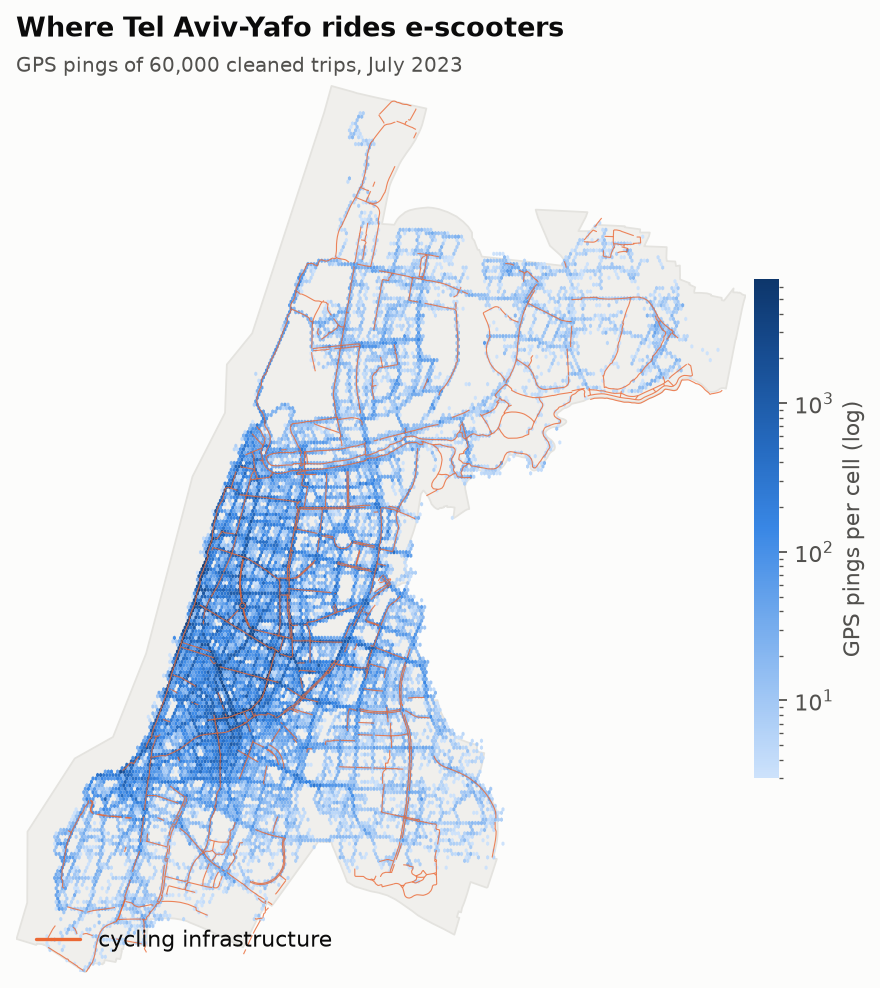
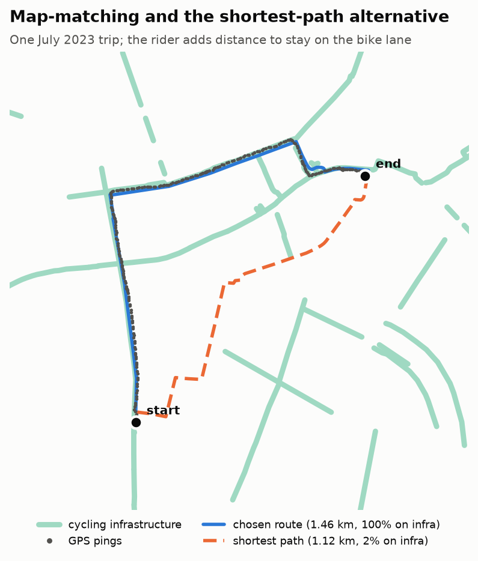
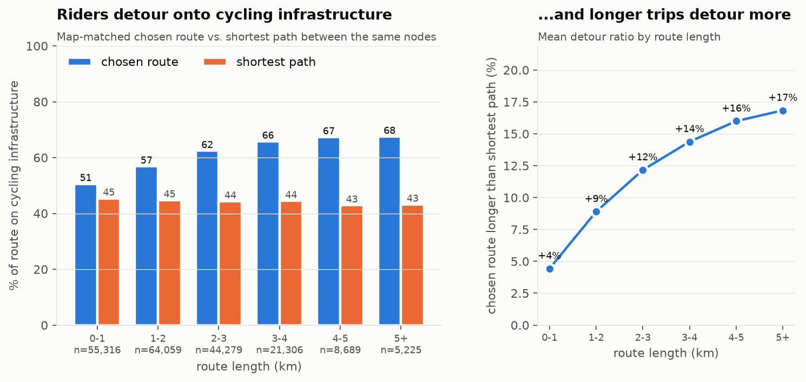
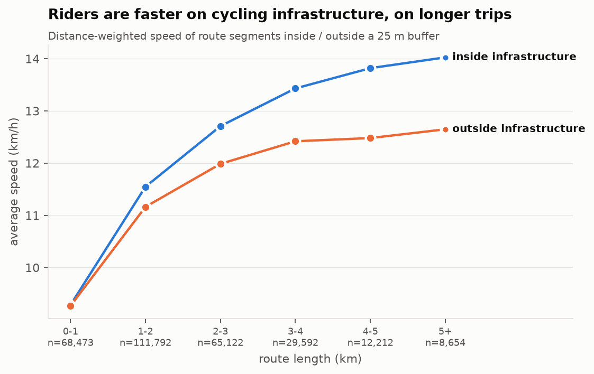
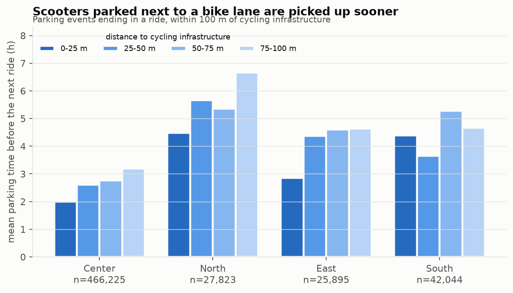
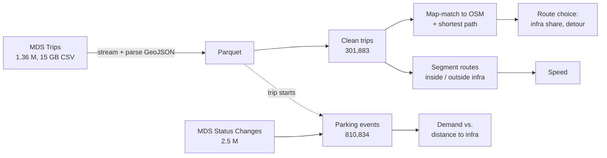
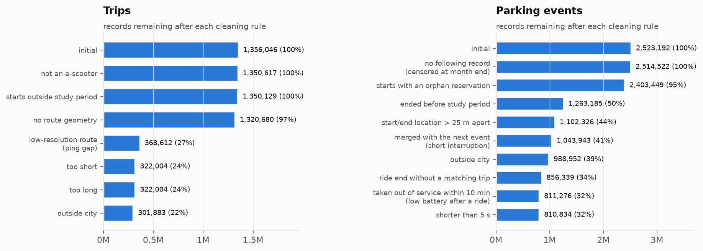

# Cycling infrastructure and shared e-scooter behaviour in Tel Aviv-Yafo

Do riders of shared dockless e-scooters (SDES) **detour to use cycling infrastructure**, are they
**faster on it**, and are scooters parked **next to it picked up sooner**?

This repository is the analysis code of my MSc thesis in Geography (Tel Aviv University, 2024),
rebuilt from research notebooks into a tested Python package. It processes one month of
municipal mobility data — **1.36 M trips with second-by-second GPS routes and 2.5 M vehicle
status changes** (July 2023) — with map-matching, network shortest paths and spatial joins.



## Key findings

| Question | Result |
|---|---|
| Do riders seek out cycling infrastructure? | Chosen routes run **58 % on cycling infrastructure vs. 44 %** for the shortest path between the same points; riders accept a **9.5 % detour** on average, growing from 4 % on trips under 1 km to 17 % over 5 km. |
| Are they faster on it? | Yes, on longer trips: on 3 km+ rides, segments on infrastructure are **~1–1.5 km/h (8–11 %) faster** than segments off it. Mean trip speed 12.9 km/h. |
| Is there more demand next to it? | Scooters parked **within 25 m** of a bike lane wait **less** before the next ride than those 75–100 m away, in every area of the city (e.g. 2.0 h vs. 3.2 h in the centre). |

<p align="center">
  
  
</p>

| | |
|---|---|
|  |  |

## Methods



* **Trip cleaning** — seven auditable rules (vehicle type, study period, GPS resolution, length,
  city boundary). The strictest keeps only routes whose consecutive pings are ≤ 70 m apart, so
  every remaining route geometry is reliable. Each rule's effect is logged (`FilterReport`):
  
* **Map-matching** — buffer the GPS track by 25 m, keep the OpenStreetMap walk-network edges
  ≥ 90 % inside it, bridge disconnected pieces (links missing from OSM), and take the shortest
  path through that sub-network. Matches deviating > 100 m (short trips) or > 5 % (long trips)
  from the GPS length are rejected.
* **Route choice** — compare the matched route with the shortest path between the same nodes on
  the full network; both are intersected with a 25 m buffer around the municipal
  cycling-infrastructure layer.
* **Speed** — split each route into runs of pings inside / outside that buffer, placing the
  transition midway between the bridging pings; runs < 80 m are treated as GPS noise.
* **Parking events** — rebuilt from the status-change feed: consecutive `available` /
  `reserved` records within 25 m form one event, short interruptions are merged, and events
  ending in a ride are linked to the actual trip (same vehicle, ≤ 1 s, ≤ 25 m).

## Engineering highlights

* **Streams a 15 GB CSV inside a `.rar`** straight into partitioned Parquet (no unpacking to
  disk), parsing each route's GeoJSON once in parallel workers.
* **Vectorised geometry** — all GPS pings of a chunk of trips are handled as one flat NumPy array
  with ragged offsets instead of per-trip Python objects (Shapely 2 / GeoPandas).
* **Record-by-record loops replaced by array logic** — the parking-event builder went from a
  stateful per-row loop over 2.5 M records to a handful of shifted-array comparisons.
* **Memory-aware parallelism** — map-matching workers each hold the city graph, so the pool is
  sized to free RAM; the run is chunked and resumable after interruption.
* **Configuration, not constants** — every threshold from the thesis lives in
  [`config/default.yaml`](config/default.yaml), loaded into typed, frozen dataclasses.
* **Tests** (pytest) for the cleaning rules, segmentation, parking logic, figures and the
  published sample; linted with ruff.

## Repository layout

```
config/default.yaml        all paths and analysis thresholds
src/sdes/
  io.py                    streaming raw-export reader, GeoParquet helpers
  geo.py                   GIS layers (lazy, cached, projected to EPSG:2039)
  report.py                FilterReport: auditable cleaning funnels
  trips/                   filtering, OSM network, map-matching, route choice, speed
  parking/events.py        parking events from status changes
  viz.py                   every figure, one function each
scripts/                   one entry point per pipeline stage (+ figures, sample, notebook)
notebooks/                 results_overview.ipynb: the analysis, top to bottom
data/sample/               100 anonymised trips + their vehicles' status changes
data/layers/               municipal GIS layers (with attribution)
tests/
```

## Running it

```bash
python -m venv .venv && source .venv/bin/activate   # Windows: .venv\Scripts\activate
pip install -e ".[dev]"
pytest

python scripts/convert_raw.py         # raw exports -> data/interim (Parquet)
python scripts/run_trips.py           # cleaning + attributes
python scripts/run_route_choice.py    # map-matching + shortest paths (resumable)
python scripts/run_speed.py
python scripts/run_parking.py
python scripts/make_figures.py        # -> docs/figures
```

Everything runs on a 16 GB laptop; map-matching all 302 k trips is the long step (~70 min with 2 workers on a memory-constrained run;
it is chunked and resumes where it stopped).

## Data

The raw data (MDS *Trips* and *Status Changes* feeds of three operators, July 2023) was
provided by the Tel Aviv-Yafo Municipality's Transportation, Mobility & Parking Authority and
**is not redistributed**. [`data/sample/`](data/sample) holds 100 trips and the matching status
changes of 10 vehicles on one day, in the original CSV layout, anonymised by
[`scripts/make_sample.py`](scripts/make_sample.py): vehicle and trip ids replaced, operator-
identifying fields blanked, timestamp and coordinate precision normalised.

GIS layers (city boundary, traffic analysis zones, city areas, cycling infrastructure) are
included in [`data/layers/`](data/layers) courtesy of the **Tel Aviv-Yafo Municipality**, which
retains all rights in them; the street network is downloaded from OpenStreetMap with OSMnx
(© OpenStreetMap contributors, ODbL).

### Differences from the thesis

The refactored pipeline re-implements the thesis methods; numbers differ slightly from the
thesis because three auxiliary layers were not available when rebuilding it (slow-speed zones,
neighbourhoods, public open space): speed has no slow-zone correction and parking events are
not filtered to public open space. Main figures:

| | Thesis | This repository |
|---|---|---|
| Clean trips | 303,710 | 301,883 |
| Infrastructure share, chosen route vs. shortest path | ~58 % vs. ~44 % | 57.8 % vs. 44.1 % |
| Mean detour (all / over 5 km) | ~9 % / ~17 % | 9.5 % / 17 % |
| Trip speed, mean / median | 12.8 / 13.1 km/h | 12.9 / 13.1 km/h |
| Parking events | 794,170 | 810,834 |
| Parking events ending in a ride | 93.1 % | 95.3 % |

## Thesis

Shahal, O. (2024). *The Impact of Cycling Infrastructure on Shared Dockless E-Scooter Riders'
Usage Patterns and Travel Behavior.* MSc thesis, Department of Geography and the Human
Environment, Porter School of Environmental and Earth Sciences, Tel Aviv University.
Supervisors: Prof. Itzhak Benenson and Prof. Itzhak Omer. [PDF](docs/thesis.pdf)

## License

Code: [MIT](LICENSE). The sample data in `data/sample/` and the GIS layers in `data/layers/`
derive from Tel Aviv-Yafo Municipality data and are not covered by the MIT licence; the thesis
text remains © the author.
